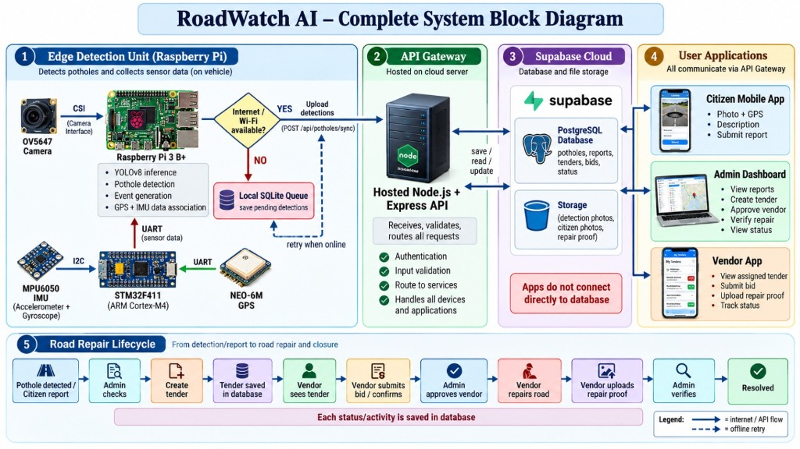
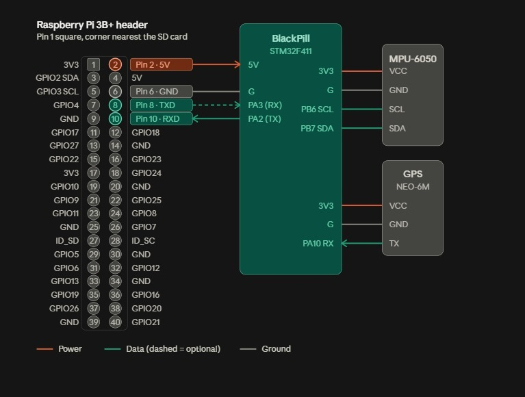

# 🛣️ RoadWatch AI — Smart Municipal Pothole Detection & E-Tendering Platform
### 🎓 Final Year Engineering Capstone Project (B.E. / B.Tech)

[](https://road-watch-ai-psi.vercel.app)
[](https://roadwatch-ai-15g9.onrender.com/api/health)
[](https://supabase.com)
[](edge_pi/)
[](https://react.dev)
[](https://nodejs.org)
[](LICENSE)

An end-to-end Smart Municipal Infrastructure and Road Maintenance System developed for **Nagpur Municipal Corporation (NMC)**. 

RoadWatch AI implements a **Dual-Tier Edge Hardware Architecture** combining an **STM32F411CEU6 Black Pill (ARM Cortex-M4 @ 100MHz)** real-time telemetry coprocessor with a **Raspberry Pi 3B+** edge vision unit, backed by an **Automated E-Tendering Engine**, **Contractor Bidding & Resolution Workspace**, and a **Public Citizen Grievance Portal** compliant with **IRC:SP:98-2020** bituminous pavement norms.

---

## 🌐 Live Deployments

- **🚀 Live Web Application (Vercel):** [https://road-watch-ai-psi.vercel.app](https://road-watch-ai-psi.vercel.app)
- **⚡ Live REST API Service (Render):** [https://roadwatch-ai-15g9.onrender.com/api/health](https://roadwatch-ai-15g9.onrender.com/api/health)
- **🛰️ Cloud Database & Storage:** Supabase PostgreSQL & Cloud Buckets
- **📦 GitHub Repository:** [https://github.com/pranay-1905/RoadWatch-AI](https://github.com/pranay-1905/RoadWatch-AI)

---

## 🎯 Final Year Project Overview

| Parameter | Details |
| :--- | :--- |
| **Project Title** | RoadWatch AI: Automated Pothole Detection, Real-Time Edge Telemetry & Municipal Tendering Platform |
| **Domain** | IoT, Embedded Systems, Computer Vision, Cloud Computing & Web Platforms |
| **Target Authority** | Nagpur Municipal Corporation (NMC) — PWD Zone 4 Dharampeth |
| **Standards Compliance** | Indian Road Congress (IRC:SP:98-2020) Pavement Norms |
| **Edge Hardware Stack** | STM32F411CEU6 Black Pill (ARM Cortex-M4 @ 100MHz) + Raspberry Pi 3B+ |
| **Cloud & Web Stack** | React 19, Node.js Express, Supabase PostgreSQL, Vercel, Render |

---

## 🌟 Key Features

### 🏎️ 1. Dual-Tier Edge IoT Telemetry (STM32 Sensor Hub + Raspberry Pi Gateway)
- **Tier 1 (STM32 Black Pill — Real-Time Sensor Hub & Telemetry Engine):**
  - **MPU-6050 IMU (I2C):** High-frequency (100Hz–200Hz) sampling of vehicle tri-axis vibration and G-force impact.
  - **NEO-6M GPS Module (UART):** Real-time hardware parsing of NMEA sentences for accurate spatial coordinates (Latitude, Longitude) and vehicle speed.
  - **Edge Thresholding & Interrupt:** Detects severe road impacts ($G_z \ge 2.0\text{G}$) and immediately dispatches a synchronized trigger packet (GPS + G-Force) to the Raspberry Pi over UART serial.
- **Tier 2 (Raspberry Pi 3B+ — Vision Gateway & Cloud Synchronization):**
  - **Pi Camera Module v2 (CSI Ribbon):** Captures high-definition road surface defect imagery triggered instantly upon receiving STM32 shock interrupt.
  - **Edge Processing & Caching:** Pairs camera snapshot with STM32 GPS/IMU telemetry and stores records in local SQLite for offline route inspection.
  - **Cloud Synchronization:** Automatically pushes batched inspection records over Wi-Fi REST API to the Node.js/Express backend on Render.

### 🏛️ 2. Municipal Authority (MNC) Command Center
- **Executive KPI Dashboard:** Real-time metrics for total potholes, critical severity hazards, active contractor tenders, and verified completed repairs.
- **Interactive Spatial GPS Route Map:** Built on Leaflet.js with live vehicle telemetry playback scrubber, route simulation, and coordinate geotagging.
- **Road Damage Inventory Register:** Comprehensive catalog of audited road defects with multi-criteria filters (Severity, Status, SLA Urgency) and CSV export for Microsoft Excel.
- **Official NMC Audit Dossier & PDF Print Engine:** Pixel-perfect printable inspection certificates and municipal work dossiers formatted per Indian Road Congress norms (`IRC:SP:98-2020`).
- **Contractor & Vendor Master Registry:** Vendor rating, accreditation class (PWD Class-1 / Class-2), active work limits, SLA audit scores, and financial disbursement tracking.

### 👷 3. Contractor & Vendor Resolution Portal
- **Live Tender Marketplace:** Browse open tenders dispatched by municipal engineers, inspect defect dimensions, and submit competitive quotation bids.
- **Active Contracts Workspace:** Track assigned resurfacing milestones, target completion dates, and SLA countdowns.
- **Geotagged Photo Evidence Submission:** High-tech HUD viewfinder simulation for uploading hot-mix asphalt compaction proofs, vibratory roller finishes, and perimeter seal geotags.
- **Payouts & Milestone Invoicing:** Track approved quality audits and automated voucher releases.

### 📢 4. Citizen Grievance & Public Reporting Portal
- **1-Click Public Complaint Lodging:** Citizens can report potholes with photo uploads, GPS coordinates, landmarks, and severity levels.
- **Live Lifecycle Tracking:** 5-stage real-time grievance tracking (`REPORTED` ➔ `VERIFIED` ➔ `TENDER_ISSUED` ➔ `IN_REPAIR` ➔ `RESOLVED`).
- **Offline Fallback Storage:** Caches citizen complaints locally in browser `localStorage` if cellular network connectivity drops.

### ⚡ 5. Operations Center Suite
- **SLA Tracker Matrix:** Live tracking of resolution windows (Critical: 24h, High: 48h, Medium: 72h) with automated overdue alerts.
- **Contractor Scorecards & Leaderboards:** Performance ranking based on speed, turnaround time, and quality verification rate.
- **Monsoon Weather Risk Analytics:** Real-time precipitation rating and road hazard enlargement index.
- **Floating AI Assistant Chatbot:** Natural language assistant to filter rain-risk defects and bulk-dispatch emergency tenders.

---

## 🏗️ System Architecture & Data Flow

<p align="center">
  
</p>

The system is organized into **5 core functional modules**:

### 1️⃣ Edge Detection Unit (On-Vehicle Raspberry Pi 3B+ & STM32F411)
- **Optical Sensing:** OV5647 Camera (5MP) connected via dedicated MIPI **CSI** bus for high-speed frame capture.
- **Sensor Fusion Coprocessor:** **STM32F411CEU6 Black Pill** (ARM Cortex-M4) acquires high-rate vibration data from **MPU6050 IMU** over **I2C** and geospatial coordinates from **NEO-6M GPS** over **UART**.
- **AI Inference & Event Association:** Raspberry Pi receives sensor packets over UART, executes **YOLOv8** computer vision inference for real-time pothole boundary detection, and binds GPS + IMU data to the detected defect.
- **Offline Fault Tolerance:** If Wi-Fi / cellular internet is unavailable, detections are buffered locally in an embedded **SQLite Queue** (`potholes.db`). As soon as connectivity is restored, the daemon automatically batches and syncs pending records (`POST /api/potholes/sync-edge`).

### 2️⃣ API Gateway (Cloud Hosted Node.js + Express Server)
- **Centralized Security Layer:** All client applications and IoT edge devices communicate strictly through this gateway (`https://roadwatch-ai-15g9.onrender.com/api`).
- **Middleware Services:** JWT authentication, role-based authorization (Municipal Admin, Contractor, Citizen), multipart file upload validation (Multer), and route orchestration.
- **Database Abstraction:** Prevents direct client exposure to raw database credentials or schema structures.

### 3️⃣ Supabase Cloud (PostgreSQL Database & Storage Buckets)
- **Relational PostgreSQL Engine:** Stores normalized relational schemas for `potholes`, `citizen_reports`, `tenders`, `contractor_bids`, and municipal audit logs with Row-Level Security (RLS).
- **Object Storage Buckets:** Secure cloud storage partitioned into:
  - `pothole-photos/edge`: Edge vehicle camera captures.
  - `pothole-photos/citizen`: Citizen grievance photos.
  - `pothole-photos/proofs`: Contractor post-resurfacing evidence.

### 4️⃣ User Applications & Portals
- **📱 Citizen Mobile Portal:** Lightweight responsive web app allowing citizens to submit geo-tagged pothole complaints with live camera photos and track resolution lifecycle.
- **💻 Municipal Admin Command Center:** Rich operational dashboard for NMC engineers featuring interactive Leaflet route maps, SLA escalation tracking, tender dispatch, and official PDF audit dossier exports.
- **👷 Vendor / Contractor Workspace:** Transparent e-tendering marketplace where accredited PWD contractors review repair specifications, submit competitive bids, and submit geotagged repair proofs.

### 5️⃣ End-to-End Road Repair Lifecycle
```
[1. Pothole Detected / Citizen Report]
                 │
                 ▼
          [2. Admin Checks]
                 │
                 ▼
         [3. Create Tender]
                 │
                 ▼
    [4. Tender Saved in Database]
                 │
                 ▼
       [5. Vendor Sees Tender]
                 │
                 ▼
  [6. Vendor Submits Bid / Confirms]
                 │
                 ▼
      [7. Admin Approves Vendor]
                 │
                 ▼
       [8. Vendor Repairs Road]
                 │
                 ▼
   [9. Vendor Uploads Repair Proof]
                 │
                 ▼
        [10. Admin Verifies]
                 │
                 ▼
          [11. RESOLVED ✅]
```

---

## ⚡ Edge Hardware Specifications & Wiring Guide

### 🖼️ Hardware Circuit & Pinout Wiring Diagram

<p align="center">
  
</p>

### 📌 Dual-Tier Hardware Assignment
| Subsystem | Sensor / Module | Host Microcontroller / SBC | Communication Protocol | Logic Level |
| :--- | :--- | :--- | :--- | :--- |
| **Telemetry Sensor Hub** | **MPU-6050 (6-DOF IMU)** | **STM32F411CEU6 Black Pill** (ARM Cortex-M4 @ 100MHz) | **I2C1** (PB6=SCL, PB7=SDA) | 3.3V |
| **Geolocation Module** | **NEO-6M GPS Receiver** | **STM32F411CEU6 Black Pill** (ARM Cortex-M4 @ 100MHz) | **USART1** (PA10=RX) | 3.3V |
| **Vision Gateway SBC** | **Raspberry Pi 3B+** | High-level Edge SBC | **USART2** (PA2=TX ➔ Pi Pin 10 RXD) | 3.3V |
| **Optical Vision Sensor** | **Pi Camera Module v2** (8MP IMX219) | **Raspberry Pi 3B+** | **15-pin CSI-2 Ribbon Bus** | MIPI CSI |

---

### 🔌 Pin-to-Pin Circuit Wiring Table

#### 1. Power Distribution (Raspberry Pi ➔ BlackPill ➔ Sensors)
| Source Device | Source Pin | Destination Device | Destination Pin | Description |
| :--- | :--- | :--- | :--- | :--- |
| **Raspberry Pi 3B+** | **Pin 2 (5V)** | **STM32F411 BlackPill** | **5V Pin** | Primary 5V power supply to STM32 |
| **Raspberry Pi 3B+** | **Pin 6 (GND)** | **STM32F411 BlackPill** | **G (GND)** | Common ground reference |
| **STM32F411 BlackPill** | **3V3 Pin** | **MPU-6050 IMU** | **VCC** | Regulated 3.3V power to IMU |
| **STM32F411 BlackPill** | **G (GND)** | **MPU-6050 IMU** | **GND** | Ground reference |
| **STM32F411 BlackPill** | **3V3 Pin** | **NEO-6M GPS** | **VCC** | Regulated 3.3V power to GPS |
| **STM32F411 BlackPill** | **G (GND)** | **NEO-6M GPS** | **GND** | Ground reference |

#### 2. MPU-6050 ➔ STM32F411CEU6 Black Pill (I2C1 Bus)
| MPU-6050 Pin | STM32F411 BlackPill Pin | Description |
| :--- | :--- | :--- |
| **VCC** | **3V3** | 3.3V Power Supply from BlackPill |
| **GND** | **G** | Common Ground |
| **SCL** | **PB6 (SCL)** | I2C1 Clock line |
| **SDA** | **PB7 (SDA)** | I2C1 Data line |

#### 3. NEO-6M GPS ➔ STM32F411CEU6 Black Pill (USART1 Bus @ 9600 Baud)
| NEO-6M GPS Pin | STM32F411 BlackPill Pin | Description |
| :--- | :--- | :--- |
| **VCC** | **3V3** | 3.3V Power Supply from BlackPill |
| **GND** | **G** | Common Ground |
| **TX** | **PA10 (RX)** | NMEA serial sentences stream into STM32 USART1 |

#### 4. STM32F411CEU6 Black Pill ➔ Raspberry Pi 3B+ (USART2 Link @ 115200 Baud)
| STM32F411 BlackPill Pin | Raspberry Pi 3B+ Header Pin | Pi Function | Description |
| :--- | :--- | :--- | :--- |
| **PA2 (TX)** | **Pin 10** | **RXD (GPIO 15)** | Transmits shock telemetry JSON packet to Pi |
| **PA3 (RX)** | **Pin 8** | **TXD (GPIO 14)** | Optional bidirectional control / handshake |
| **5V** | **Pin 2** | **5V Power** | Receives 5V bus power from Pi header |
| **G** | **Pin 6** | **GND** | Common ground reference |

#### 5. Pi Camera Module v2 ➔ Raspberry Pi 3B+
| Camera Interface | Raspberry Pi Interface | Description |
| :--- | :--- | :--- |
| **15-pin Ribbon Cable** | **CSI Camera Port** (Between HDMI & 3.5mm Audio) | Dedicated MIPI CSI-2 bus for zero-latency 1080p road surface snapshots |

---

### 💡 Why Dual-Tier (STM32 + Raspberry Pi)? — Engineering Viva Justification
During final year engineering project evaluations, examiners frequently probe the rationale behind using both an STM32 microcontroller and a Raspberry Pi. The technical reasons are:

1. **Deterministic Real-Time Sampling (Zero OS Jitter):**
   - The **STM32 ARM Cortex-M4** runs bare-metal firmware with deterministic microsecond interrupt handling. Mechanical pothole shocks produce transient acceleration spikes lasting only 10ms–30ms. An embedded RTOS / bare-metal micro runs at a fixed 100Hz–200Hz loop without the multi-tasking kernel scheduling jitter (~10ms–50ms) inherent in Linux (Raspberry Pi OS).
2. **Dedicated Peripheral Offloading:**
   - The STM32 continuously handles high-throughput I2C reading from the MPU-6050 and non-blocking UART parsing of NEO-6M NMEA sentences ($GPRMC / $GPGGA) without consuming CPU cycles or memory bandwidth on the Raspberry Pi.
3. **Decoupled Edge Vision & Networking:**
   - The **Raspberry Pi 3B+** dedicates its Quad-Core 1.4GHz processor to running the camera capture pipeline (`libcamera`), managing local SQLite offline caching, and orchestrating encrypted TLS HTTP/REST batch syncs to the cloud backend.
4. **Hardware Safety & Direct 3.3V Logic:**
   - Both the STM32 Black Pill and Raspberry Pi 3B+ operate on 3.3V logic levels, allowing direct connection across USART and GPIO interrupt lines without requiring bi-directional logic level converter chips.

---

## 📁 Repository Structure

```
pothole_react_dashboard/
├── frontend/                     # React 19 + Vite Web Application
│   ├── src/
│   │   ├── components/
│   │   │   ├── auth/            # Split-screen role login & portals
│   │   │   ├── citizen/         # Public grievance reporting form
│   │   │   ├── layout/          # Sidebar, TopHeader, AI Chatbot
│   │   │   ├── mnc/             # KPI Cards, LiveMap, IncidentFeed, DamageInventory, AnalyticsView
│   │   │   ├── operations/      # SLA Tracker, Vendor Scorecards, Weather Risk
│   │   │   └── vendor/          # Contractor Marketplace, Bidding, Photo Submission
│   │   ├── data/                # Initial Nagpur Zone 4 survey & auth fixtures
│   │   ├── services/            # Frontend API client (VITE_API_BASE_URL dynamic resolver)
│   │   ├── styles/              # Modular Vanilla CSS System
│   │   │   ├── App.css          # Master stylesheet index
│   │   │   ├── layout.css       # Design tokens, typography, header, sidebar
│   │   │   ├── auth.css         # Split login screen styles
│   │   │   ├── vendor.css       # Contractor portal & bidding cards
│   │   │   ├── modal.css        # Inspection HUD & geotag modals
│   │   │   ├── vendorMaster.css # Contractor directory styles
│   │   │   ├── citizen.css      # Citizen grievance portal styling
│   │   │   ├── operations.css   # Operations suite & SLA matrix styles
│   │   │   ├── responsive.css   # Mobile & tablet media query breakpoints
│   │   │   └── print.css        # Official NMC audit dossier print styling
│   │   ├── App.jsx              # Application root state & routing
│   │   └── main.jsx             # React entry point
│   ├── vercel.json              # Vercel SPA client-side routing rewrites
│   └── package.json             # Frontend dependencies (React, Leaflet, Chart.js)
│
├── backend/                      # Node.js + Express REST API Server
│   ├── src/
│   │   ├── config/              # Supabase Client & Multer photo upload
│   │   ├── controllers/         # Potholes, Tenders, Vendors, Citizen controllers
│   │   ├── routes/              # Express API route declarations
│   │   └── middlewares/         # Global error handler & request validation
│   ├── schema.sql               # PostgreSQL schema & RLS security policies
│   ├── server.js                # Express application entry point
│   └── package.json             # Backend dependencies (Express, Multer, Supabase-js)
│
├── edge_pi/                      # IoT Hardware Edge Subsystem
│   ├── stm32_firmware_telemetry.ino # STM32 Black Pill firmware (MPU-6050 + NEO-6M GPS + Trigger)
│   ├── edge_stm32_listener.py   # Raspberry Pi serial listener & camera snapshot trigger
│   └── edge_pi_sync.py          # Offline SQLite caching & automated cloud sync daemon
│
├── .gitignore                   # Multi-tier ignore rules (protects .env & secrets)
└── README.md                    # Project documentation
```

---

## 💻 Tech Stack

| Layer | Technologies |
| :--- | :--- |
| **Frontend Framework** | React 19, Vite 8 |
| **Styling** | Modular Vanilla CSS (9 Specialized Stylesheets, Off-White Municipal Theme) |
| **Maps & Visualization** | Leaflet.js, React-Leaflet, Chart.js, React-Chartjs-2 |
| **Icons & Typography** | Lucide-React, Inter Font Family |
| **Backend Framework** | Node.js, Express.js |
| **Database & Cloud Storage** | Supabase (PostgreSQL 15, Row Level Security, Object Storage) |
| **File Uploads** | Multer, Multipart Form-Data |
| **Deployment & Hosting** | Vercel (Frontend SPA), Render (Backend Web Service) |
| **IoT Edge Hardware** | STM32 Black Pill (ARM Cortex-M4), Raspberry Pi 3B+, Pi Camera v2, NEO-6M GPS, MPU-6050 IMU |

---

## 🛠️ Local Development Setup

### Prerequisites
- Node.js (v18.0.0 or higher)
- npm or yarn
- Git

### 1. Clone the Repository
```bash
git clone https://github.com/pranay-1905/RoadWatch-AI.git
cd RoadWatch-AI
```

### 2. Configure Backend
```bash
cd backend
npm install
```

Create a `.env` file in the `backend/` folder:
```env
PORT=5000
SUPABASE_URL=https://your-project.supabase.co
SUPABASE_KEY=your-supabase-service-or-anon-key
UPLOAD_DIR=./uploads
```

Start the backend server:
```bash
npm start
```
*Backend runs on `http://localhost:5000` (Health check: `http://localhost:5000/api/health`).*

---

### 3. Configure Frontend
Open a new terminal window:
```bash
cd frontend
npm install
npm run dev
```
*Frontend runs on `http://localhost:5173`.*

---

## 🔑 Demo Credentials

| Role | Username / Email | Password | Access Area |
| :--- | :--- | :--- | :--- |
| **MNC Municipal Executive** | `admin@nmc.gov.in` | `admin123` | Full Municipal Command Center |
| **Road Contractor / Vendor** | `vendor@apex.com` | `vendor123` | Bidding & Proof Submission Portal |
| **Public Citizen** | *1-Click Access* | *No Auth* | Public Grievance Form & Tracking |

---

## 📡 REST API Endpoints

| Method | Endpoint | Description |
| :--- | :--- | :--- |
| `GET` | `/api/health` | Server status & Supabase connectivity check |
| `GET` | `/api/potholes` | Fetch road defects with optional filters |
| `POST`| `/api/potholes/sync-edge` | Ingest edge batch telemetry from Raspberry Pi / STM32 |
| `GET` | `/api/tenders` | List open municipal tenders & bidding state |
| `POST`| `/api/tenders` | Issue a new resurfacing e-tender |
| `POST`| `/api/tenders/:id/bid` | Submit contractor quotation bid |
| `GET` | `/api/citizen/reports` | Retrieve citizen grievances |
| `POST`| `/api/citizen/report` | Submit citizen report with multi-photo evidence |
| `GET` | `/api/citizen/track/:id` | Real-time status tracking by Tracking ID |

---

## 📜 Indian Road Congress Compliance

RoadWatch AI adheres to standard municipal specifications:
- **IRC:SP:98-2020:** Guidelines for maintenance, resurfacing, and patch repair of bituminous pavements.
- **SLA Escalation Protocol:**
  - `CRITICAL` (>10cm depth, heavy traffic): 24-hour repair window
  - `HIGH` (Rainfall prone, arterial): 48-hour repair window
  - `MEDIUM` / `LOW` (Residential): 72-hour repair window

---

## 👨‍💻 Author & Project Credits

**Pranay Chikankar**  
*Final Year Engineering Student (B.E. / B.Tech)*  
- GitHub: [@pranay-1905](https://github.com/pranay-1905)
- Project Repository: [RoadWatch-AI](https://github.com/pranay-1905/RoadWatch-AI)

---

## 📄 License

This project is licensed under the MIT License — see the [LICENSE](LICENSE) file for details.
